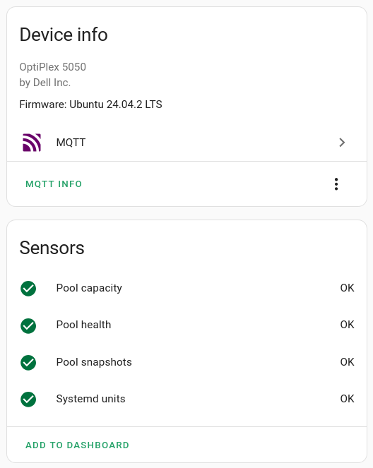

# SystemPub

[](https://copr.fedorainfracloud.org/coprs/adneos/systempub/)
[](https://launchpad.net/~ykgmfq/+archive/ubuntu/systempub)

SystemPub monitors your ZFS pools and systemd units, and reports their state to Home Assistant via MQTT.
It is built for [sanoid](https://github.com/jimsalterjrs/sanoid) users who want simple, self-hosted monitoring without running a full monitoring stack or relying on a cloud service.

It tracks ZFS pool health and capacity, sanoid snapshot freshness, and failed systemd units.
The last point makes it easy to notice when `syncoid` has silently stopped syncing snapshots on a backup machine.

All sensors appear in Home Assistant automatically through MQTT autodiscovery — no extra configuration required.



## Fire drill

A fire drill checks that your alerts in Home Assistant actually reach you, without waiting for a real failure.
During a drill, SystemPub picks one problem sensor or error counter at random and reports it as failing for a few minutes.
Every sensor that a drill can target has a `fire_drill` attribute, which is `true` only during the drill, so your alert can tell a drill from a real problem.
No drill runs while the system is degraded, which means any sensor reports a real problem or any error counter is above zero.

Drills run on a schedule once you enable their timer:

```sh
systemctl enable --now systempub-firedrill.timer
```

To change the schedule, override `OnCalendar=` with `systemctl edit systempub-firedrill.timer`.
To run a drill right away, use `systemctl start systempub-firedrill.service`.

The length of a drill and the value an error counter jumps to can be set in `/etc/systempub.yaml`:

```yaml
firedrill:
  duration: 5m
  errorcount: 42
```
